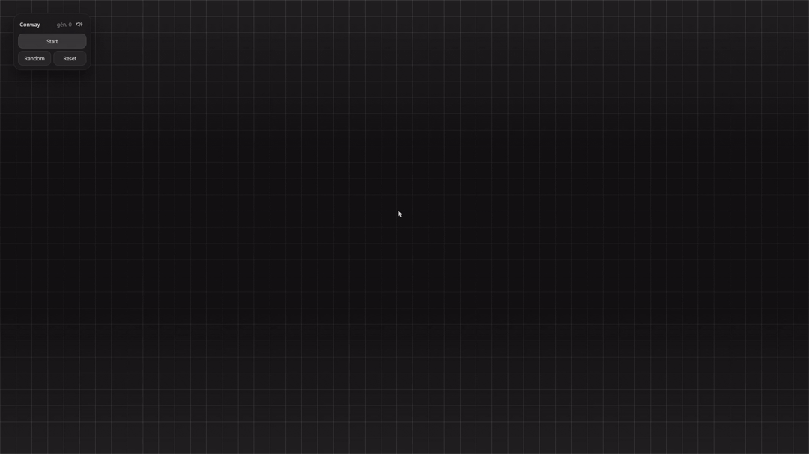

<div align="center">

<br><br>

# CONWAY: GAME OF LIFE

A minimalist, dark, interactive cellular automaton wallpaper for Windows.


<br>

[](https://github.com/rocksdanister/lively/releases)
[](#install)
[](#)
[](https://opensource.org/license/mit)

</div>

<br>

## About

Every cell is alive or dead. Each generation, four rules decide what happens next. No script, no animation: patterns move, grow, stabilize and vanish on their own.

This wallpaper renders that process on your desktop, in real time, using the HTML Canvas API through [Lively Wallpaper](https://github.com/rocksdanister/lively).

<div align="center">

</div>

<br>

## Conway's Rules

| Cell | Neighbors | Next state |
|:--|:--:|:--:|
| Alive | < 2 | Dead |
| Alive | 2 or 3 | Alive |
| Alive | > 3 | Dead |
| Dead | exactly 3 | Alive |

<br>

## Install

1. Install [Lively Wallpaper](https://github.com/rocksdanister/lively/releases) ([Microsoft Store](https://apps.microsoft.com/detail/9NTM2QC6QWS7)).
2. Download the `ConwayWallpaper.zip` file but don't extract it.
3. In Lively, add a new wallpaper and select the ZIP file (or drag it).
4. Apply it.

Keep all files in the same folder, otherwise settings or previews will not load.

<br>

## Settings

Available in Lively's customization panel.

| Setting | Default | Range |
|:--|:--:|:--:|
| Simulation speed | 10 gen/s | 1 – 30 |
| FPS limit | 30 | 10 – 120 |
| Cell size | 38 | 12 – 48 |
| Sound effects | On | On / Off |
| Volume | 50% | 0 – 100% |
| Blur | On | On / Off |

For lower resource usage: reduce the FPS limit and turn blur off.

<br>

## Files

```text
index.html             wallpaper and simulation
LivelyInfo.json        metadata
LivelyProperties.json  settings
thumbnail.png          static preview
preview.gif            animated preview
```

<div align="center">
<br>
<sub>Simple rules. Endless possibilities.</sub>
</div>
